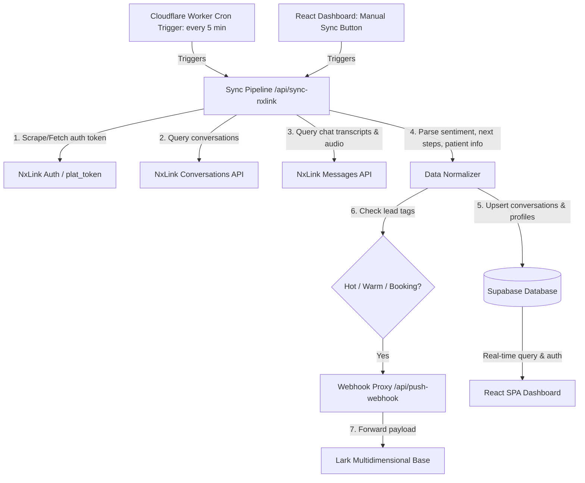

# NxLink CRM & Data Bridge (DentalHome)

A modern full-stack CRM dashboard and automated data synchronization bridge. This system connects **NxLink AI Flow Manager**, **Supabase PostgreSQL**, and **Lark Multidimensional Base Webhooks** to centralize customer conversations, extract patient metadata, provide operational analytics, and route qualified leads in real time.

---

## 1. System Architecture & Data Flow



### Core Architecture Components:
1. **Frontend (Vite + React 19 + Tailwind CSS v4)**: An administrative and support portal for reviewing conversations, listening to call recordings, tracking customer interactions, managing internal users, and viewing database capacity metrics.
2. **Cloudflare Worker (`worker/index.ts`)**: Edge runtime hosting API endpoints, scheduled cron jobs (`*/5 * * * *`), and serving frontend production assets (`dist/`).
3. **Database (Supabase PostgreSQL)**: Stores normalized conversations, phone-indexed customer profiles, RBAC user profiles, application settings, and webhook audit logs.
4. **Outbound Lark Webhook Proxy**: Securely forwards qualified leads to Lark Multidimensional tables with client credentials and HMAC signing.

---

## 2. Key Features & Modules

- **Conversations Dashboard (`/`)**:
  - Live conversation stream with channel indicators (`Website`, `WA`, `FB`, `IG`).
  - Embedded audio player for phone/call recordings.
  - Formatted transcript viewer with AI-extracted sentiment, appointment next steps, preferred branch, date, and treatment.
  - Manual sync trigger and individual webhook retry buttons.
  - Date filtering (today, yesterday, this week, custom date ranges) and CSV export.
- **Customer Directory (`/customers`)**:
  - Consolidated customer directory keyed by unique phone number.
  - Tracks total customer touchpoints, health score ratings, and last active timestamp.
- **Reports & Analytics (`/reports`)**:
  - Visual breakdown of sentiment distribution, conversion rates, and branch volume.
- **User Management & RBAC (`/users`)**:
  - Manage application access and role assignment (`admin`, `support`, `sales`).
  - Synchronized directly with Supabase Auth identities via `/api/manage-user`.
- **Database Metrics (`/db-metrics`)**:
  - Monitors Supabase PostgreSQL storage usage, table row byte overhead, daily incoming traffic rate, and projected days/years until free-tier capacity limits are reached.
- **Dynamic App Settings (`/app-settings`)**:
  - Allows administrators to update the destination Lark Webhook URL dynamically in Supabase without requiring a code rebuild or redeployment.
- **Technical API Docs (`/api-docs`)**:
  - Integrated documentation and test payload templates for `/api/ingest-crm` and Lark webhook payloads.

---

## 3. Technology Stack

- **Frontend**:
  - [React 19](https://react.dev/) + [TypeScript](https://www.typescriptlang.org/)
  - [Vite 6](https://vite.dev/)
  - [Tailwind CSS v4](https://tailwindcss.com/)
  - [React Router v7](https://reactrouter.com/)
  - [Lucide React](https://lucide.dev/) (Icons)
- **Backend & Edge**:
  - [Cloudflare Workers](https://workers.cloudflare.com/) (`worker/index.ts`)
  - [Cloudflare Workers Static Assets](https://developers.cloudflare.com/workers/static-assets/)
  - [Wrangler CLI](https://developers.cloudflare.com/workers/wrangler/)
  - Alternative legacy support: [Netlify Functions](https://www.netlify.com/products/functions/)
- **Database & Authentication**:
  - [Supabase](https://supabase.com/) (PostgreSQL with Row Level Security & Supabase Auth)
- **External APIs**:
  - NxLink AI Admin Flow Manager & Open API
  - Lark Base / Lark Open Platform Webhooks

---

## 4. Environment Variables Configuration

Create a `.env` file in the root directory for local development:

```bash
# Supabase Configuration
VITE_SUPABASE_URL=https://<your-project-id>.supabase.co
VITE_SUPABASE_ANON_KEY=eyJhbGciOi...
SUPABASE_URL=https://<your-project-id>.supabase.co
SUPABASE_SERVICE_ROLE_KEY=eyJhbGciOi...

# Internal API Secret
API_SECRET_KEY=your_secure_internal_api_key

# Webhook Integration (Lark Base)
NXLINK_WEBHOOK_URL=https://<lark-webhook-endpoint>
NXLINK_WEBHOOK_CLIENT_ID=<lark-client-id>
NXLINK_WEBHOOK_CLIENT_SECRET=<lark-client-secret>

# Automated Sync Interval (Minutes)
NXLINK_SYNC_INTERVAL_MINUTES=5

# NxLink Authentication (Optional fallback or token service)
NXLINK_PLAT_TOKEN=eyJhbGciOi...
NXAI_TOKEN_URL=https://<token-service-url>
```

| Variable | Scope | Description |
|---|---|---|
| `VITE_SUPABASE_URL` | Client & Worker | Public URL for Supabase API |
| `VITE_SUPABASE_ANON_KEY` | Client & Worker | Public anonymous key for client queries |
| `SUPABASE_URL` | Worker / Node | Supabase project URL for server functions |
| `SUPABASE_SERVICE_ROLE_KEY` | Worker / Node | Service role key (bypasses RLS for sync & user administration) |
| `API_SECRET_KEY` | Worker / Node | Secret key used for authenticating internal requests |
| `NXLINK_WEBHOOK_URL` | Worker / Node | Default outbound webhook destination for qualifying leads |
| `NXLINK_WEBHOOK_CLIENT_ID` | Worker / Node | Client ID for webhook authentication |
| `NXLINK_WEBHOOK_CLIENT_SECRET` | Worker / Node | Client Secret for webhook authentication |
| `NXLINK_PLAT_TOKEN` | Worker / Node | Static fallback NxLink bearer token |
| `NXAI_TOKEN_URL` | Worker / Node | Shared service endpoint to fetch a dynamic `plat_token` |

---

## 5. Local Development Setup

### Prerequisites
- Node.js (v20+ recommended)
- npm or pnpm
- Python 3 with Playwright (only if using `nxlink_get_plat_token.py` for headless auth scraping)

### Installation
```bash
# Clone the repository and navigate into the folder
cd nxlink-crm

# Install dependencies
npm install
```

### Running the Frontend Locally
```bash
npm run dev
```
Runs the Vite development server on `http://localhost:5173`. In development, Vite includes built-in middleware (`netlifyFunctionsDevPlugin`) simulating the `/api/sync-nxlink` route directly.

### Running Cloudflare Worker Locally
```bash
npm run cf:dev
```
Builds the project and simulates the Cloudflare Worker runtime and static asset hosting via `wrangler dev`.

### Running Manual Sync Scripts
```bash
# Run one-off sync against NxLink and store records in Supabase
npm run sync:local

# Trigger batch webhook sync for unpushed leads
npm run sync:webhook
```

---

## 6. Deployment Methods

### Method A: Cloudflare Workers (Primary / Production)

The primary deployment runs on **Cloudflare Workers** using Worker Static Assets. A single deployment command compiles the Vite SPA into `./dist` and uploads the worker bundle along with scheduled cron triggers.

#### 1. Cloudflare Login
Ensure you are logged into your Cloudflare account with Wrangler:
```bash
npx wrangler login
```

#### 2. Configure Worker Variables & Secrets
Check `wrangler.jsonc`. Variables that are non-sensitive can be placed under `"vars"`, while sensitive keys should be registered as secrets in Cloudflare:

```bash
# Set secrets on Cloudflare Workers
npx wrangler secret put SUPABASE_SERVICE_ROLE_KEY
npx wrangler secret put NXLINK_WEBHOOK_CLIENT_SECRET
npx wrangler secret put NXLINK_PLAT_TOKEN
```

#### 3. Build & Deploy
Deploy both the frontend bundle and edge worker in one step:
```bash
npm run deploy
```
*(Executes `tsc -b && vite build && wrangler deploy`)*

#### 4. Scheduled Worker Crons
The sync trigger is defined in `wrangler.jsonc`:
```jsonc
"triggers": {
  "crons": ["*/5 * * * *"]
}
```
Every 5 minutes, Cloudflare automatically triggers `runNxlinkSync(env)` to fetch fresh conversations and push qualified leads without requiring external schedulers.

---

### Method B: Netlify (Alternative / Legacy)

The repository also includes configuration for hosting on Netlify:
- **Build settings** are controlled in `netlify.toml`:
  - Build command: `npm run build`
  - Publish directory: `dist`
  - Functions directory: `netlify/functions`
  - Cron trigger: `[functions."sync-nxlink-cron"]` runs every 5 minutes (`*/5 * * * *`).
- **Deploying to Netlify**:
  1. Link the repository to Netlify via Git or run `npx netlify deploy --build --prod`.
  2. Populate the required environment variables in **Netlify Dashboard > Site Configuration > Environment Variables**.

---

### Method C: Database Initialization (Supabase)

Before deploying the frontend or worker, initialize the database tables, indexes, and Row Level Security policies:
1. Open your project in the **Supabase Dashboard**.
2. Navigate to the **SQL Editor**.
3. Copy and run the contents of [`supabase_schema.sql`](./supabase_schema.sql).
4. The schema creates:
   - `conversations`: Primary record table with channel, sentiment, metadata, and webhook sync statuses.
   - `customer_profiles`: Consolidated profile table aggregated by phone number.
   - `profiles`: Application users with roles (`admin`, `support`, `sales`).
   - `app_settings`: Key-value storage for dynamic runtime settings (e.g., dynamic webhook URL).
   - `webhook_logs`: Incoming payload logs for auditability.

---

## 7. Webhook Lead Qualification Rules

When the sync job runs (via cron or manual trigger), conversations are evaluated against specific tag rules before being forwarded to the Lark Base webhook:

- **Qualified Leads**: Must contain tags such as `hot lead`, `warm lead`, or `booking appointment`.
- **Exclusions**:
  - Conversations tagged exclusively with routing tags (`to agent`, `branch agent`, `contact agent`) are excluded.
  - Conversations tagged with `emergency` or `check booking` are filtered out of automated lead routing.
- **Sync Tracking**: When successfully pushed, `conversations.webhook_status` updates to `synced` along with a timestamp in `webhook_synced_at`.

---

## 8. Useful NPM Scripts Reference

| Command | Action |
|---|---|
| `npm run dev` | Starts local Vite development server |
| `npm run build` | Compiles TypeScript and builds production frontend bundle |
| `npm run cf:dev` | Builds frontend and starts local Cloudflare Worker preview |
| `npm run deploy` | Builds and deploys application to Cloudflare Workers |
| `npm run sync:local` | Manually runs synchronization script via Node.js CLI |
| `npm run sync:webhook` | Re-checks unpushed leads and pushes them to the configured webhook |
| `npm run lint` | Runs Oxlint for code quality and linter checks |
